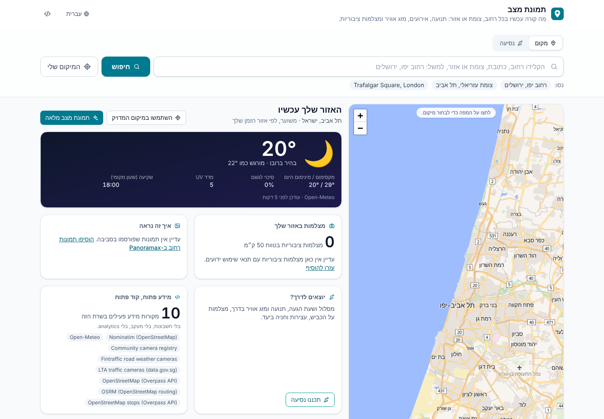

<div dir="rtl">

# תמונת מצב · AI Street Situation

**אפליקציית קוד פתוח להתקנה עצמית שמציגה תמונת מצב עדכנית לכל רחוב, צומת או אזור.**
כותבים כתובת ומקבלים מצב תנועה, אירועי תנועה, מזג אוויר, מצלמות ציבוריות
סמוכות (כשתנאי השימוש שלהן מתירים זאת) וסיכום קצר שנכתב ב-AI. הסיכום מציין מאיזה
מקור הגיע כל נתון ומה חסר.

[English](README.md) · [מקורות מידע](docs/sources.md) · [הוספת מצלמה](docs/adding-a-camera.md) · [הוספת ספק](docs/adding-a-provider.md) · [תרומה לפרויקט](CONTRIBUTING.md)

**עם נתונים אמיתיים ובלי אף מפתח API** (מפת OpenFreeMap, ‏Nominatim, ‏Open-Meteo, חניונים מ-OpenStreetMap):




מצלמות לאורך המסלול, מהפיד הפתוח של מצלמות הכבישים בפינלנד (הלסינקי ← טמפרה, נתונים אמיתיים):


איך זה נראה כאן: תמונות רחוב מ-Panoramax בירושלים (נתונים אמיתיים):


**כל היכולות, כולל סיכום AI, תנועה, אירועים ומצלמות** (נתוני בדיקה משרת דמה, לא נתונים אמיתיים):


## יכולות

- **חיפוש בעברית ובאנגלית** של רחובות, צמתים, כתובות ואזורים, או לחיצה על המפה. קישורים ניתנים לשיתוף.
- **מזג אוויר** מ-Open-Meteo (חינמי, בלי מפתח).
- **תנועה ואירועי תנועה** מ-TomTom או HERE (עם מפתח משלכם), יחד עם **פידים פתוחים של עבודות בכביש** בתקן WZDx.
- **חיפוש חניה**: חניונים קרובים מ-OpenStreetMap עם סוג, מספר מקומות, תשלום, גישה ושעות פתיחה, סינון (חינם / ציבורי), סימון במפה וניווט בלחיצה ב-Waze, ב-Google Maps או ב-OpenStreetMap. בלי מפתח. (ל-OSM אין נתוני תפוסה בזמן אמת, והאפליקציה אומרת זאת במפורש.) בישראל החניונים והעצירות בדרך מגיעים מקובץ OpenStreetMap מוכן שמגיע עם האפליקציה, כך שהם עובדים גם כששרתי Overpass הציבוריים לא זמינים.
- **תכנון נסיעה**: „ירושלים ← תל אביב” מציג את המסלול על המפה, מרחק וזמן נסיעה, **מזג אוויר לאורך הדרך לפי השעה שבה תגיעו לכל נקודה**, תחנות דלק ואזורי מנוחה בדרך עם המתקנים שלהם, אירועים לאורך המסלול וחניה ביעד. אפשר לצאת עכשיו או **לבחור שעת יציאה עד שבוע קדימה**: מזג האוויר מחושב לשעה הזו, ועם TomTom זמן ההגעה לפי התנועה הצפויה בה. הניווט חינמי עם OSRM (השרת של openstreetmap.org); עם מפתח TomTom זמן ההגעה כולל תנועה בזמן אמת והקטעים האיטיים מסומנים על המסלול.
- **מפת וקטור** של OpenFreeMap (חינמית, בלי מפתח ובלי מגבלת שימוש) עם MapLibre, ומעבר אוטומטי לאריחי raster במקרה הצורך.
- **דף בית על האזור שלך**: מזג האוויר עכשיו והיום (מקסימום/מינימום, סיכוי לגשם, UV, שקיעה), כמה מצלמות ציבוריות יש בטווח 50 ק״מ עם תצוגה חיה, תמונות שפורסמו בסביבה וקיצורי דרך לתמונת מצב מלאה או לנסיעה. המיקום המדויק משמש רק אם אישרתם, ומעוגל לכ-1 ק״מ; אחרת האזור נקבע לפי אזור הזמן של הדפדפן, בלי זיהוי לפי IP.
- **מצלמות ציבוריות** ממאגר JSON קהילתי ומפידים ממשלתיים פתוחים: מצלמות מזג האוויר בכבישי פינלנד ומצלמות התנועה של סינגפור פועלות מהקופסה, לונדון (TfL) והונג קונג בהפעלה ידנית. **מצלמות חיות מ-YouTube** מהמאגר מוצגות בנגן של YouTube במצב הפרטיות המוגברת. תמונה מוטמעת **רק** כשתנאי השימוש של המקור מתירים זאת. אחרת מוצג קישור למקור. מכירים מפעיל מצלמה? [מכתב בקשת האישור](docs/camera-permission-request.md) (עברית ואנגלית) מוכן לשליחה.
- **מצלמות לאורך המסלול**: בתכנון נסיעה מוצגות כל המצלמות המותרות במרחק עד 300 מ׳ מהמסלול, לפי סדר המעבר לידן ועם "בעוד 25 דק׳", כדי לראות את הדרך לפני שיוצאים.
- **איך זה נראה כאן**: תמונות שפורסמו של המקום ושל יעד הנסיעה, מתמונות הרחוב של **Panoramax** ומ**ויקישיתוף**, עם תאריך הצילום, שם הצלם והרישיון. בלי מפתח; פנים ולוחיות רישוי בתמונות הרחוב מטושטשים על ידי Panoramax.
- **ניתוח תמונה וסיכום AI** דרך מודל פתוח מקומי (Ollama) או Anthropic API. ה-AI רואה רק תמונות שמותר לנתח, מפריד בין מה שנצפה בתמונה לבין נתוני ספקים, מציין אי-ודאות, ולעולם לא מזהה אנשים או לוחיות רישוי.
- **שקיפות לגבי עדכניות**: לכל נתון מוצגים המקור והגיל שלו (בזמן אמת / עדכני חלקית / מידע ישן). נתונים חסרים מפורטים ולא מנוחשים.
- **עברית ו-RTL כברירת מחדל**, אנגלית מובנית, ותשתית i18n להוספת שפות.
- **פרטיות**: בלי חשבונות, בלי analytics, בלי מעקב. תמונות מצלמה נשמרות בזיכרון לכמה דקות לכל היותר ולא נכתבות לדיסק. החריג היחיד הוא מצלמות YouTube: כשפותחים אחת, הדפדפן טוען את הנגן של YouTube מ-`youtube-nocookie.com`.

## התחלה מהירה

נדרש Node.js בגרסה 20.9 ומעלה (מומלץ 22).

</div>

```bash
git clone https://github.com/yossi123654/ai-street-situation.git
cd ai-street-situation
npm install
npm run dev
```

<div dir="rtl">

פתחו את <http://localhost:3000>. **לא צריך שום מפתח API.** מהקופסה מקבלים חיפוש כתובות (Nominatim), מזג אוויר (Open-Meteo), חיפוש חניה (OpenStreetMap דרך Overpass), מפת OpenFreeMap, את מאגר המצלמות הקהילתי את פידי המצלמות הפתוחים של פינלנד וסינגפור ותמונות מ-Panoramax ומוויקישיתוף. תנועה, אירועים ו-AI מופעלים על ידי הוספת מפתחות לקובץ `.env.local` (העתיקו את `.env.example`; כל הערכים אופציונליים):

| כדי להפעיל                     | הגדירו                                                             |
| ------------------------------ | ------------------------------------------------------------------ |
| זרימת תנועה ואירועים           | `TOMTOM_API_KEY` או `HERE_API_KEY`                                 |
| סיכום וניתוח AI (מקומי וחינמי) | `OLLAMA_URL=http://localhost:11434` ואז `ollama pull qwen2.5vl:7b` |
| סיכום וניתוח AI (שירות מנוהל)  | `ANTHROPIC_API_KEY`                                                |
| מצלמות תנועה בלונדון           | `TFL_APP_KEY` (הרשמה חינמית)                                       |
| מצלמות תנועה בהונג קונג        | `HK_TRAFFIC_CAMERAS_ENABLED=true` (קראו קודם את התנאים)            |
| חיפוש כתובות טוב יותר בעברית   | `GEOCODING_PROVIDER=google` ו-`GOOGLE_MAPS_API_KEY`                |

לוח **ספקי הנתונים** בתחתית העמוד מראה אילו ספקים פעילים ומה כל ספק צריך.

### Docker

</div>

```bash
docker compose up --build                      # http://localhost:3000
docker compose --profile ollama up --build     # כולל Ollama מקומי
```

<div dir="rtl">

### העלאת הדגמה ציבורית

</div>

[](https://render.com/deploy?repo=https://github.com/yossi123654/ai-street-situation)

```bash
docker run --rm -p 3000:3000 ghcr.io/yossi123654/ai-street-situation:latest
```

<div dir="rtl">

בלחיצה אחת ב-Render ([`render.yaml`](render.yaml)), עם `fly deploy` ב-Fly.io ([`fly.toml`](fly.toml)), או בכל שרת עם Docker. הצעדים ורשימת הבדיקות לפני שמשתפים קישור ציבורי נמצאים ב-[docs/deploy.md](docs/deploy.md).

### לפני פרסום לציבור

ברירות המחדל מצביעות על שירותים קהילתיים חינמיים: ל-OpenFreeMap אין מגבלת שימוש אבל גם אין התחייבות לזמינות, שרת Overpass (חניה) משותף לכל הקהילה ולשימוש כבד כדאי להריץ שרת עצמי, Nominatim מגביל לבקשה אחת בשנייה לכל השרת (האפליקציה אוכפת זאת ושומרת תוצאות ב-cache), וה-API החינמי של Open-Meteo מיועד לשימוש לא מסחרי. פרטים מלאים ב-[docs/sources.md](docs/sources.md).

## תרומה לפרויקט

נשמח במיוחד ל**מקורות מצלמה מאומתים** (בעיקר בישראל), **ספקים** חדשים (למשל נתוני תנועה פתוחים ממשלתיים) ו**תרגומים**. התחילו ב-[CONTRIBUTING.md](CONTRIBUTING.md).

## רישיון

[MIT](LICENSE). נתונים ממקורות חיצוניים כפופים לרישיון שלהם ויש לייחס אותם כפי שמוצג באפליקציה.

</div>
