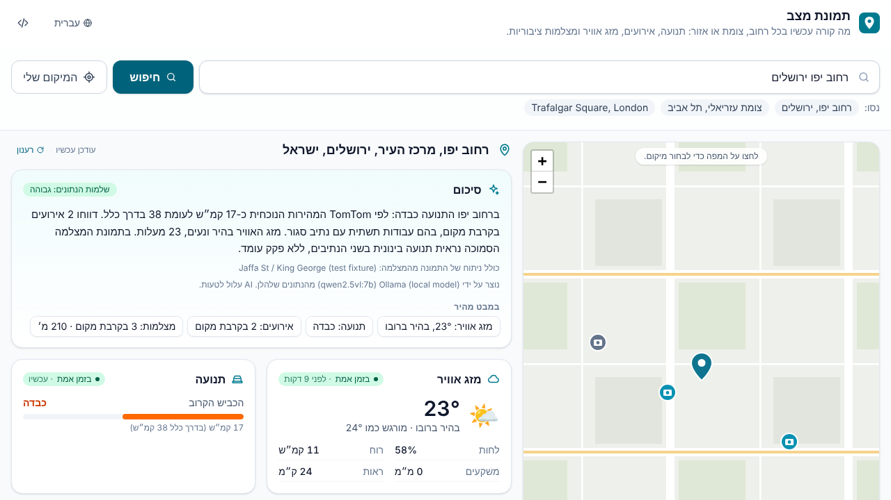

<div dir="rtl">

# תמונת מצב · AI Street Situation

**אפליקציית קוד פתוח להתקנה עצמית שמציגה תמונת מצב עדכנית לכל רחוב, צומת או אזור.**
כותבים כתובת ומקבלים מצב תנועה, אירועי תנועה, מזג אוויר, מצלמות ציבוריות
סמוכות (כשתנאי השימוש שלהן מתירים זאת) וסיכום קצר שנכתב ב-AI. הסיכום מציין מאיזה
מקור הגיע כל נתון ומה חסר.

[English](README.md) · [מקורות מידע](docs/sources.md) · [הוספת מצלמה](docs/adding-a-camera.md) · [הוספת ספק](docs/adding-a-provider.md) · [תרומה לפרויקט](CONTRIBUTING.md)



> צילומי המסך נוצרים מול שרת דמה עם נתונים מומצאים ותמונת מצלמה סינתטית, כי סביבת הבנייה אינה מגיעה לשירותים האמיתיים.

## יכולות

- **חיפוש בעברית ובאנגלית** של רחובות, צמתים, כתובות ואזורים, או לחיצה על המפה. קישורים ניתנים לשיתוף.
- **מזג אוויר** מ-Open-Meteo (חינמי, בלי מפתח).
- **תנועה ואירועי תנועה** מ-TomTom או HERE (עם מפתח משלכם).
- **מצלמות ציבוריות** ממאגר JSON קהילתי ומספקים כמו TfL JamCams. תמונה מוטמעת **רק** כשתנאי השימוש של המקור מתירים זאת. אחרת מוצג קישור למקור.
- **ניתוח תמונה וסיכום AI** דרך מודל פתוח מקומי (Ollama) או Anthropic API. ה-AI רואה רק תמונות שמותר לנתח, מפריד בין מה שנצפה בתמונה לבין נתוני ספקים, מציין אי-ודאות, ולעולם לא מזהה אנשים או לוחיות רישוי.
- **שקיפות לגבי עדכניות**: לכל נתון מוצגים המקור והגיל שלו (בזמן אמת / עדכני חלקית / מידע ישן). נתונים חסרים מפורטים ולא מנוחשים.
- **עברית ו-RTL כברירת מחדל**, אנגלית מובנית, ותשתית i18n להוספת שפות.
- **פרטיות**: בלי חשבונות, בלי analytics, בלי מעקב. תמונות מצלמה נשמרות בזיכרון לכמה דקות לכל היותר ולא נכתבות לדיסק.

## התחלה מהירה

נדרש Node.js בגרסה 20.9 ומעלה (מומלץ 22).

</div>

```bash
git clone https://github.com/yossi123654/ai-street-situation.git
cd ai-street-situation
npm install
npm run dev
```

<div dir="rtl">

פתחו את <http://localhost:3000>. **לא צריך שום מפתח API.** מהקופסה מקבלים חיפוש כתובות (Nominatim), מזג אוויר (Open-Meteo), מפת OpenStreetMap ואת מאגר המצלמות הקהילתי. תנועה, אירועים ו-AI מופעלים על ידי הוספת מפתחות לקובץ `.env.local` (העתיקו את `.env.example`; כל הערכים אופציונליים):

| כדי להפעיל                     | הגדירו                                                             |
| ------------------------------ | ------------------------------------------------------------------ |
| זרימת תנועה ואירועים           | `TOMTOM_API_KEY` או `HERE_API_KEY`                                 |
| סיכום וניתוח AI (מקומי וחינמי) | `OLLAMA_URL=http://localhost:11434` ואז `ollama pull qwen2.5vl:7b` |
| סיכום וניתוח AI (שירות מנוהל)  | `ANTHROPIC_API_KEY`                                                |
| מצלמות תנועה בלונדון           | `TFL_APP_KEY` (הרשמה חינמית)                                       |
| חיפוש כתובות טוב יותר בעברית   | `GEOCODING_PROVIDER=google` ו-`GOOGLE_MAPS_API_KEY`                |

לוח **ספקי הנתונים** בתחתית העמוד מראה אילו ספקים פעילים ומה כל ספק צריך.

### Docker

</div>

```bash
docker compose up --build                      # http://localhost:3000
docker compose --profile ollama up --build     # כולל Ollama מקומי
```

<div dir="rtl">

### לפני פרסום לציבור

ברירות המחדל מצביעות על שירותים קהילתיים חינמיים עם מדיניות שימוש מחמירה: אריחי OpenStreetMap מיועדים לשימוש קל, Nominatim מגביל לבקשה אחת בשנייה לכל השרת (האפליקציה אוכפת זאת ושומרת תוצאות ב-cache), וה-API החינמי של Open-Meteo מיועד לשימוש לא מסחרי. פרטים מלאים ב-[docs/sources.md](docs/sources.md).

## תרומה לפרויקט

נשמח במיוחד ל**מקורות מצלמה מאומתים** (בעיקר בישראל), **ספקים** חדשים (למשל נתוני תנועה פתוחים ממשלתיים) ו**תרגומים**. התחילו ב-[CONTRIBUTING.md](CONTRIBUTING.md).

## רישיון

[MIT](LICENSE). נתונים ממקורות חיצוניים כפופים לרישיון שלהם ויש לייחס אותם כפי שמוצג באפליקציה.

</div>
