# AI Street Situation · תמונת מצב

**Open-source, self-hostable situation reports for any street, junction or area.**
Type an address and get the current traffic, incidents and weather, nearby
public cameras where their terms allow it, and a short AI-written summary that
says which source each fact came from and what is missing.

[עברית](README.he.md) · [Data sources](docs/sources.md) · [Add a camera](docs/adding-a-camera.md) · [Add a provider](docs/adding-a-provider.md) · [Contributing](CONTRIBUTING.md)

**Live, with real data and no API keys** (OpenFreeMap map, Nominatim, Open-Meteo, OpenStreetMap parking):

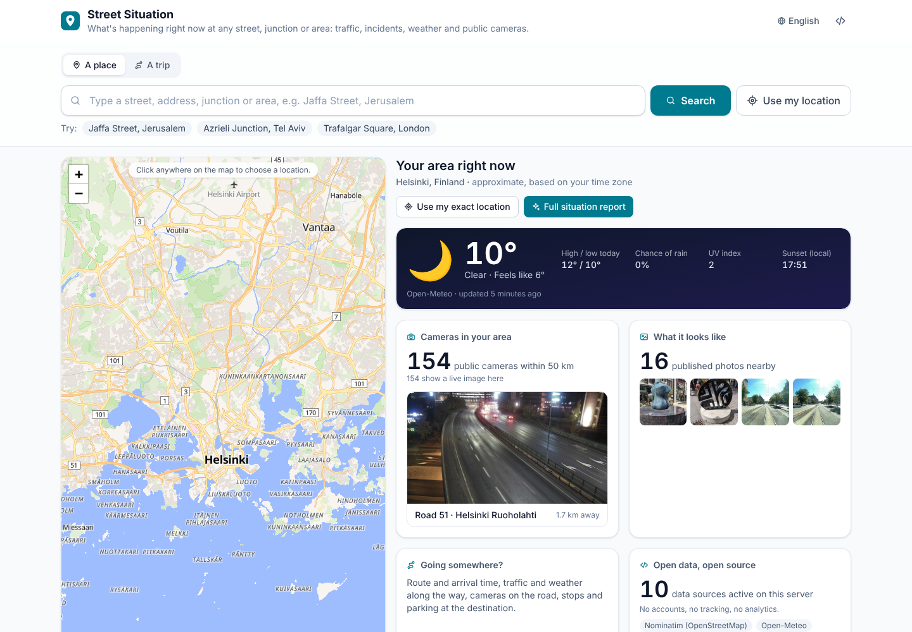

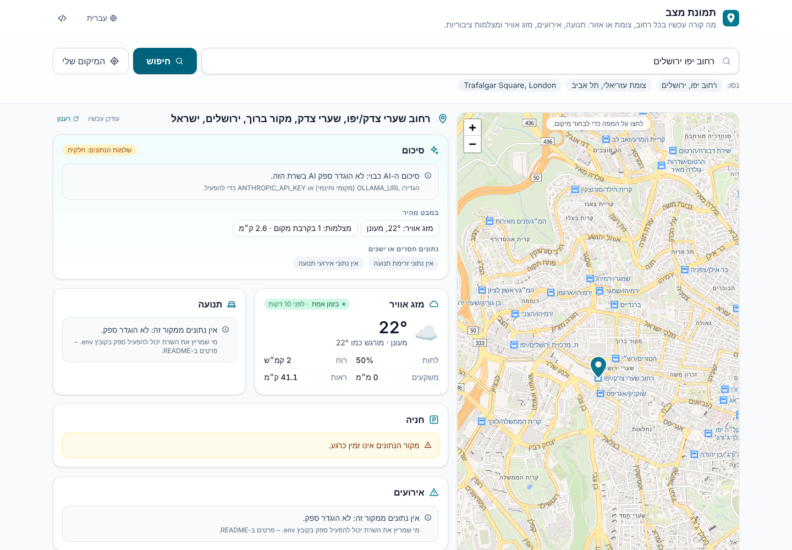

|                                                                            |                                                                    |
| -------------------------------------------------------------------------- | ------------------------------------------------------------------ |
| 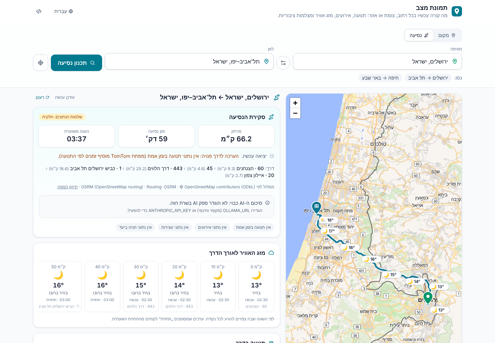 | 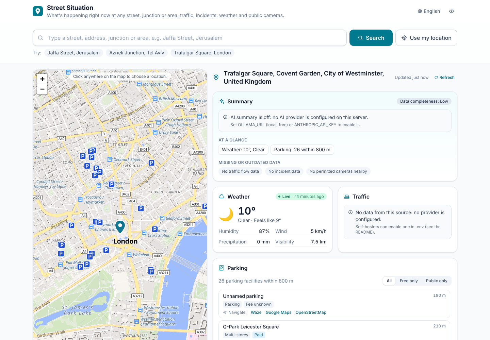 |

Cameras along the route, from Finland's open road-camera feed (Helsinki → Tampere, real data):

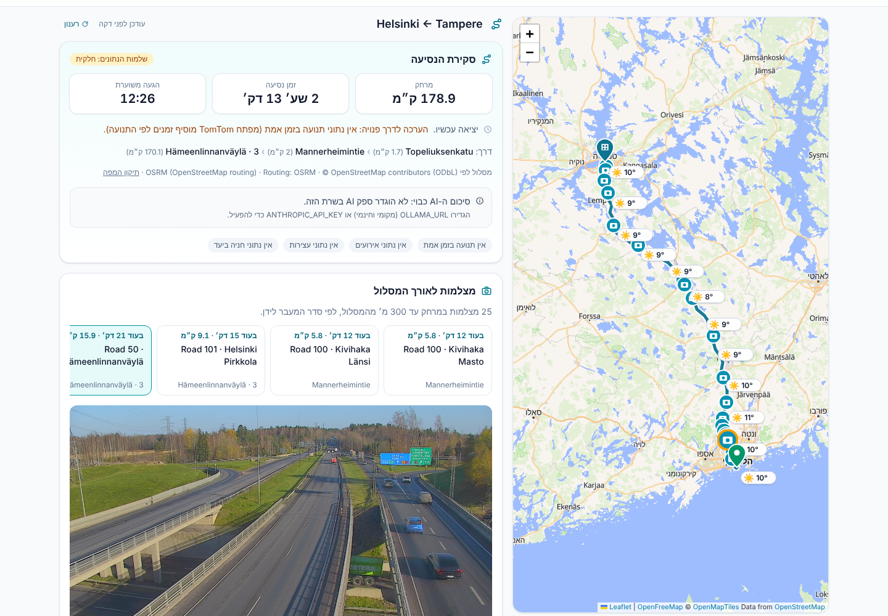

What it looks like here: Panoramax street-level photos in Jerusalem (real data):

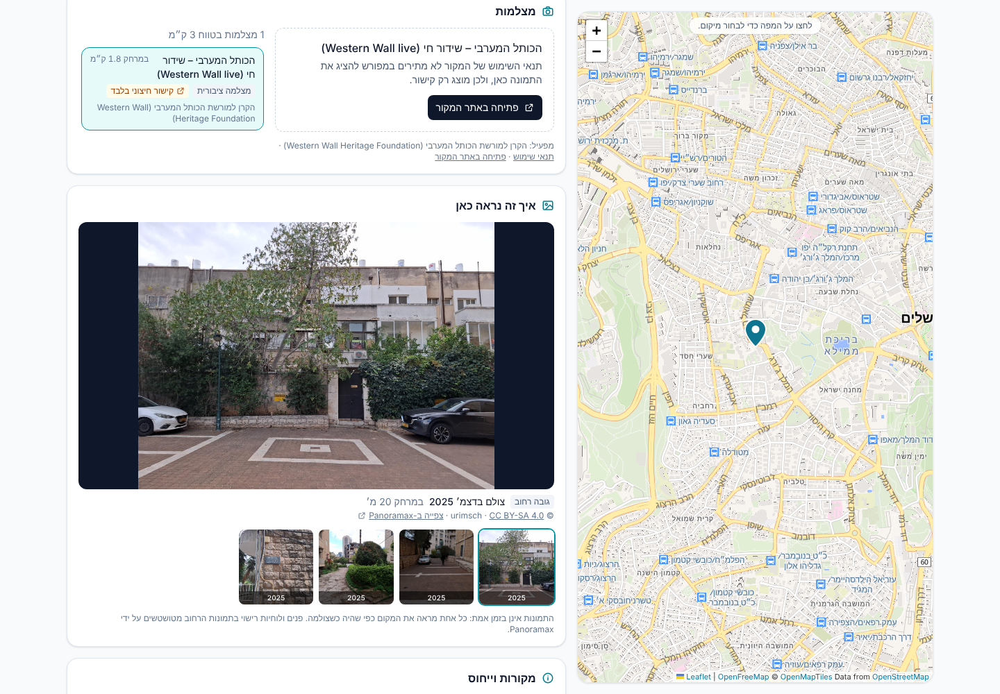

<details>
<summary>All features, including AI summary, traffic, incidents and cameras (test fixtures)</summary>

|                                                                   |                                                                |
| ----------------------------------------------------------------- | -------------------------------------------------------------- |
|  | 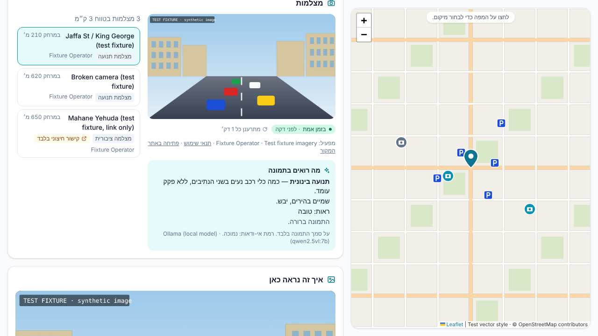 |
| 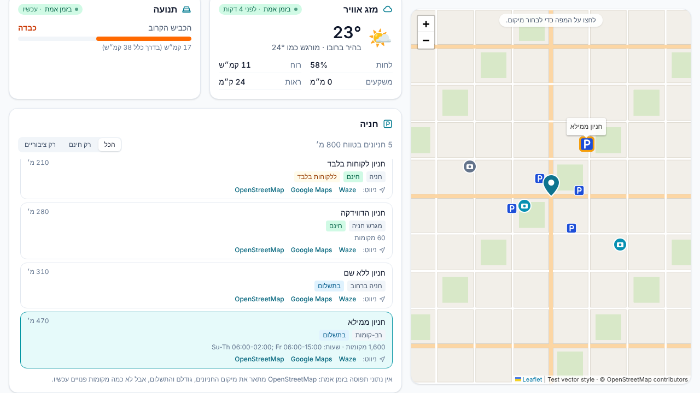                | 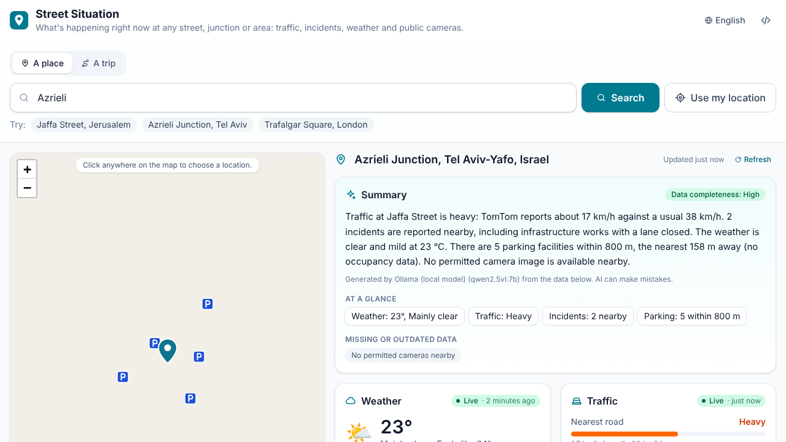                  |
| 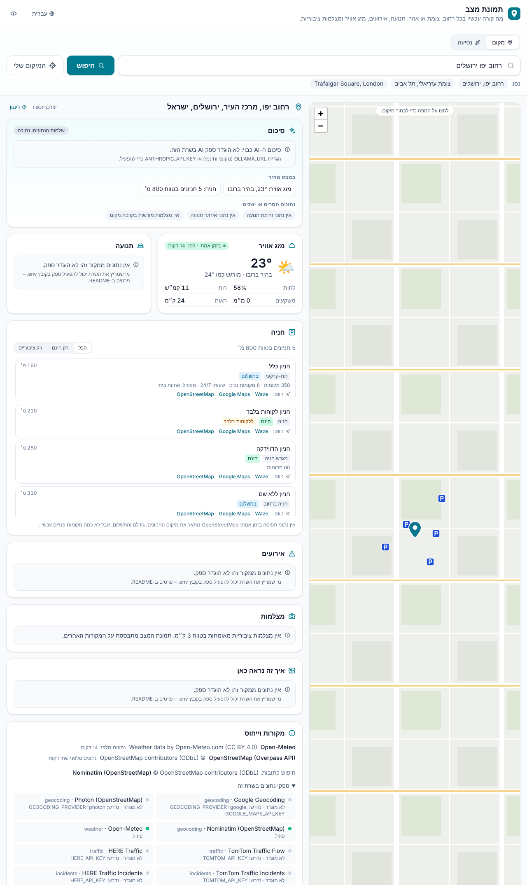           | 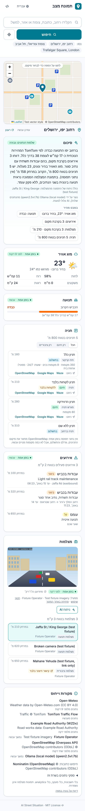                      |

These screenshots are generated by `npm run screenshots` against a **mock
upstream server** (`tests/e2e/mock-upstream.mjs`) with made-up traffic,
incidents, AI responses and a synthetic camera image, so that features which
need API keys can be shown and tested offline. The map in them is a synthetic
street grid.

</details>

## Features

- **Search in Hebrew or English** for streets, junctions, addresses and areas,
  or click on the map. Shareable URLs (`?lat=…&lon=…`).
- **Weather** from Open-Meteo (free, no key).
- **A home page about your area**: the weather now and today (high/low,
  rain chance, UV, sunset), how many public cameras there are within 50 km
  with a live preview, published photos nearby, and quick links to a full
  report or a trip. Your exact location is used only if you allow it, and
  is rounded to about 1 km; otherwise the area comes from your browser's
  time zone, with no IP lookup.
- **Hebrew addresses typed the Israeli way**: "רח' הרצל 10 ת"א", "שד'
  רוטשילד" or "בן יהודה 5 י-ם" are rewritten before geocoding (prefixes,
  abbreviations, Hebrew quote marks), and results in the wrong city are
  dropped.
- **Traffic flow and incidents** from TomTom or HERE (bring your own key),
  merged with **open road-work feeds** in the WZDx standard.
- **Parking search**: nearby car parks from OpenStreetMap with type,
  capacity, fee, access and opening hours, filters (free / public), map
  markers and one-tap navigation in Waze, Google Maps or OpenStreetMap. No
  key needed. (OSM has no live occupancy, and the app says so.) In Israel
  parking and stops come from a prebuilt OpenStreetMap extract that ships
  with the app, so they work even when public Overpass servers are down.
- **Trip planning**: "Jerusalem → Tel Aviv" gives the route on the map,
  distance and travel time, the **weather along the route for the time you
  will be at each point**, fuel stations and rest areas on the way with
  their facilities, incidents in the corridor, and parking at the
  destination. Leave now or **pick a departure time up to a week ahead**:
  the weather follows that time, and with TomTom the ETA uses the traffic
  predicted for it. Routing is free with OSRM (openstreetmap.org's own
  server); with a TomTom key the ETA includes live (or predicted) traffic and
  slow sections are drawn on the route.
- **Vector map** from OpenFreeMap (free, no key, no usage limits) rendered
  with MapLibre, with automatic fallback to raster tiles.
- **Public cameras** from a community-maintained JSON registry and from
  open government feeds: Finland's road weather cameras and Singapore's
  traffic cameras work out of the box, London (TfL) and Hong Kong are
  opt-in. **YouTube live cameras** from the registry play in YouTube's
  privacy-enhanced player. Images are embedded **only**
  when the source's terms allow it; otherwise the app links to the source.
  Know an operator? The [permission request letter](docs/camera-permission-request.md)
  (Hebrew and English) is ready to send.
- **Cameras along your route**: a trip lists every permitted camera within
  300 m of the route in the order you pass it, with "in 25 min" labels, so
  you can see the road ahead before you leave.
- **What it looks like here**: published photos of the place and of a
  trip's destination, from **Panoramax** street-level imagery and **Wikimedia
  Commons**, with the date each was taken, the author and the licence. No
  key; faces and plates in street-level imagery are blurred by Panoramax.
- **AI image analysis and summary** through a local open-weight model
  (Ollama) or the Anthropic API. AI only sees camera images whose terms
  allow it, keeps camera observations apart from provider data, states
  uncertainty, and never identifies people or licence plates.
- **Honest freshness**: every data block shows its source and age, and is
  labelled live, recent or outdated. Missing data is listed, never guessed.
- **Hebrew (RTL) by default, English included**, with i18n built in so the
  community can add languages.
- **Privacy**: no accounts, no analytics, no tracking. Camera images are kept
  in memory for at most a few minutes and never written to disk. YouTube
  cameras are the one exception to "no third parties": when you open one,
  your browser loads YouTube's player from `youtube-nocookie.com`.

## Quick start

Requirements: Node.js 20.9+ (22 recommended).

```bash
git clone https://github.com/yossi123654/ai-street-situation.git
cd ai-street-situation
npm install
npm run dev
```

Open <http://localhost:3000>. **No API key is needed.** Out of the box you
get geocoding (Nominatim), weather (Open-Meteo), parking (OpenStreetMap via
Overpass), the OpenFreeMap vector map, the community camera registry and the
open camera feeds of Finland and Singapore, and photos from Panoramax and
Wikimedia Commons. Traffic, incidents and AI are switched on by adding
keys:

```bash
cp .env.example .env.local   # then edit; every value is optional
```

| To enable                                   | Set                                                                |
| ------------------------------------------- | ------------------------------------------------------------------ |
| Traffic flow + incidents                    | `TOMTOM_API_KEY` or `HERE_API_KEY`                                 |
| AI summary and image analysis (local, free) | `OLLAMA_URL=http://localhost:11434` and `ollama pull qwen2.5vl:7b` |
| AI summary and image analysis (hosted)      | `ANTHROPIC_API_KEY`                                                |
| London traffic cameras                      | `TFL_APP_KEY` (free registration)                                  |
| Hong Kong traffic cameras                   | `HK_TRAFFIC_CAMERAS_ENABLED=true` (read the terms first)           |
| Better Hebrew geocoding                     | `GEOCODING_PROVIDER=google` and `GOOGLE_MAPS_API_KEY`              |

The **providers panel** at the bottom of the page shows which providers are
active and which variables each one needs.

### Docker

The published image needs no build:

```bash
docker run --rm -p 3000:3000 ghcr.io/yossi123654/ai-street-situation:latest
```

Or build it yourself with Compose:

```bash
docker compose up --build                      # app on http://localhost:3000
docker compose --profile ollama up --build     # app + local Ollama
docker compose exec ollama ollama pull qwen2.5vl:7b
# then set OLLAMA_URL=http://ollama:11434 in .env and restart the app
```

Configuration is read from `.env` at runtime, so one image works for every
deployment.

Behind an outbound proxy, start the server with `NODE_USE_ENV_PROXY=1`
(Node ≥ 22.21) so that `fetch` honours `HTTPS_PROXY`.

### Deploy a public demo

[](https://render.com/deploy?repo=https://github.com/yossi123654/ai-street-situation)

One click with Render ([`render.yaml`](render.yaml)), `fly deploy` with
Fly.io ([`fly.toml`](fly.toml)), or any server with Docker. See
[docs/deploy.md](docs/deploy.md) for the steps and the checklist before
sharing a public link.

### Before you deploy publicly

> **You are responsible for following the usage policies of the free services
> this app uses by default.** In particular, the
> [Nominatim usage policy](https://operations.osmfoundation.org/policies/nominatim/)
> applies to every deployment: at most 1 request/second in total, an
> identifying User-Agent, no autocomplete, and only moderate, user-triggered
> traffic. It also says LLM-generated code must comply with it and that the
> public API must not be built into no-code or "vibe-coding" platforms. This
> project enforces the technical rules, but the decision to use the public
> instance is yours. The server logs a reminder at startup.

The defaults point at free community services with strict usage policies:

- **OpenFreeMap** is free with no limits but has no SLA. For guaranteed
  uptime, self-host it or set `MAP_STYLE_URL` to another provider. The raster
  fallback (OpenStreetMap tiles) is for light use only.
- **OSRM** (trips) on routing.openstreetmap.de allows one request per
  second and fair use only. Self-host OSRM or set `ROUTING_PROVIDER=tomtom`
  for real traffic.
- **Overpass** (parking, stops) is a shared community server. For heavy or
  commercial use, run your own and set `OVERPASS_URLS`.
- **Nominatim** allows 1 request/second for your whole server (the app
  enforces this and caches results). Set `APP_USER_AGENT` with a contact URL,
  or run your own Nominatim.
- **Open-Meteo**'s free API is for non-commercial use.

See [docs/sources.md](docs/sources.md) for terms and limits of every source.

## How it works

```
Browser (Next.js + React + Leaflet, i18n)
   │  /api/geocode  /api/situation  /api/summary  /api/cameras/:id/{image,status,analyze}
   ▼
Next.js route handlers ── rate limiting, input validation, uniform errors
   ▼
Services
   LocationService            geocoding + 24 h cache
   SituationService           weather + traffic + incidents + cameras, in parallel
   ParkingService             nearby parking, 12 h cache
   TripService                route → weather at ETA per point, traffic, incidents, stops, parking
   CameraRegistry             merges camera providers, Haversine search
   CameraImageService         fetches registry images only (SSRF-safe), memory-only
   CameraAvailabilityService  is the camera up, and how old is the image
   VisionAnalyzer             AI image description, cached per image hash
   SituationSummaryService    AI summary from structured facts
   ▼
Providers (src/providers, swappable, enabled by configuration)
   geocoding: nominatim · photon · google      weather: open-meteo
   traffic: tomtom · here                      incidents: tomtom · here · WZDx feeds
   cameras: community JSON (incl. YouTube) · TfL · Fintraffic · data.gov.sg · Hong Kong TD
   parking: overpass (OSM)                     photos: panoramax · wikimedia commons
   routing: osrm · tomtom (live traffic)       stops: overpass (OSM)
   ai: ollama · anthropic
```

Each part of a report fails independently: if TomTom is down, the weather
still shows and the traffic card says the source is unavailable.

## Development

```bash
npm run dev               # dev server
npm run check             # lint + typecheck + camera validation + unit tests
npm test                  # unit tests (Vitest)
npm run build && npm run test:e2e   # end-to-end tests (Playwright, offline mock upstreams)
npm run screenshots       # regenerate docs/screenshots
npm run validate:cameras  # validate data/cameras
```

End-to-end tests run the real app against `tests/e2e/mock-upstream.mjs`,
which imitates Nominatim, Open-Meteo, TomTom (traffic and routing), OSRM, a
WZDx feed, Overpass, Ollama, camera images, a vector map style and raster tiles. They need no network access and no keys.

## Contributing

Contributions are welcome, especially **verified camera sources**, new
**providers** (national open-data traffic feeds in particular), and
**translations**. Start with [CONTRIBUTING.md](CONTRIBUTING.md).

## License

[MIT](LICENSE). Data from third-party sources remains under its own licence
and must be attributed as shown in the app. See [docs/sources.md](docs/sources.md).
